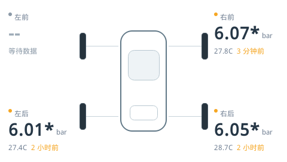
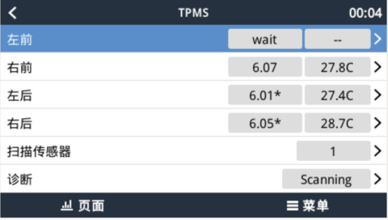

# TPMS

在 CCGX 上接收并显示胎压传感器数据。插件同时支持：

- BLE TPMS 广播
- RTL-SDR USB 接收的 433.92 MHz Steelmate（铁将军）协议 59

主 Dashboard 可直接查看四轮胎压，设备列表中的 `TPMS` 页面用于发现传感器并绑定左前、右前、左后、右后四个轮位。BLE 和 433 MHz 使用统一的数据模型与轮位配置。接收模式默认为“自动”，也可以手动选择“仅蓝牙”或“仅 433 MHz”；未选择的接收链路会被完全停止。

## Dashboard

## TPMS 页面

## 使用

1. 将 RTL-SDR USB 适配器插入 GX；只使用 BLE 时可省略。
2. 在 `Settings > Plugins` 中安装并启用 TPMS。
3. 从设备列表打开 `TPMS`。
4. 等待发现传感器，然后将其绑定到对应轮位。

433 MHz 接收器固定使用 `433.92 MHz`、`250 kS/s`、32 KiB 缓冲区，并且仅启用 rtl_433 协议 59。因此环境里的 Toyota 等其他 TPMS 广播不会出现在绑定列表中。已验证的 Steelmate ID 包括旧款单只传感器 `0xc4f2`，以及 `0x7721`、`0x3d10`、`0xfffd`、`0x0f6d`。

433 MHz 胎压传感器在静止时可能长时间不广播；安装、压力变化或车辆行驶时更容易收到数据。已绑定的 433 MHz 读数在 30 分钟后标记为过期，BLE 读数在 5 分钟后标记为过期。

## 诊断

`TPMS > 诊断` 分别显示蓝牙和 433 MHz 接收器状态。433 MHz 诊断会区分 FSK 射频活动、Steelmate 解码尝试、被校验拒绝的数据和有效 Steelmate 帧，因此有效帧为 `0` 不再被误解为接收器没有工作。接收器每 30 秒报告一次运行心跳；只有心跳连续 90 秒中断时，插件才会重启 `rtl_433`，没有胎压广播本身不会触发重启。

拔掉 RTL-SDR 后，插件会先完整终止并回收旧的 `rtl_433` 进程，再按 5、10、20、40、60 秒进行有上限的退避重试。重新收到运行心跳后重试计数才会清零，避免适配器缺失时每 5 秒持续创建短命进程。

## 第三方软件

安装包内含为 CCGX 定制的静态 ARMv7 `rtl_433`。它通过低内存补丁和 32 KiB 运行缓冲区避免 stock rtl_433 在 CCGX 上的大块预分配。版本、源码、补丁、许可证与复现命令见 [THIRD_PARTY.md](THIRD_PARTY.md)。
